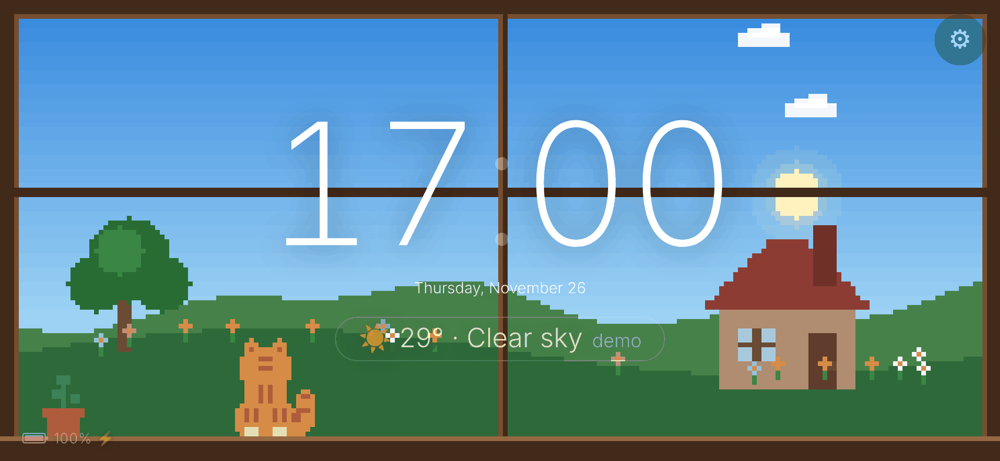
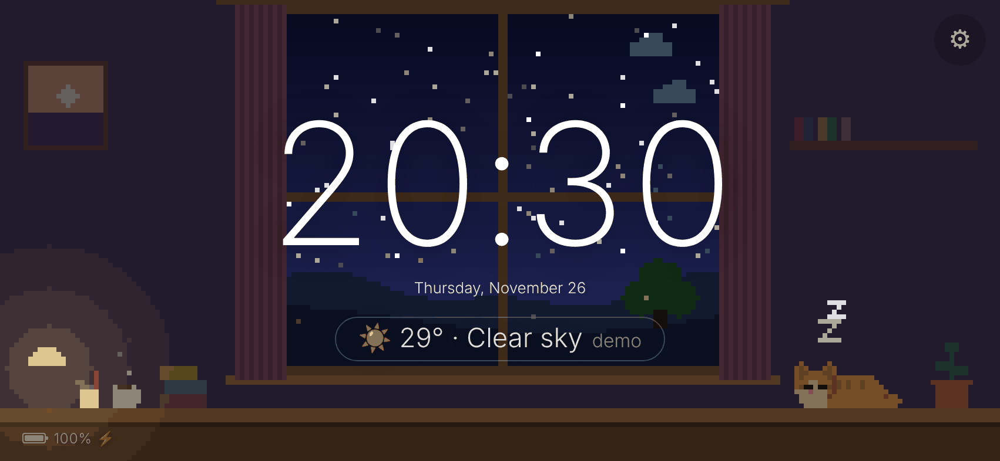
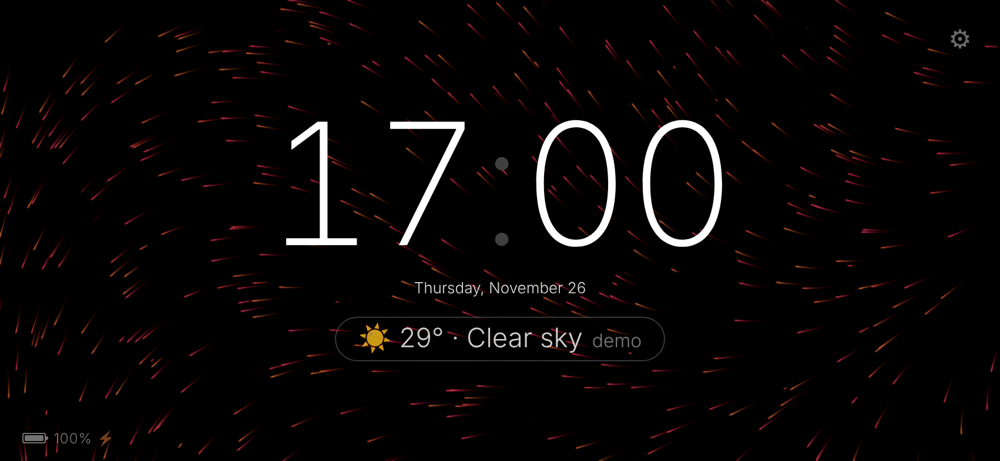
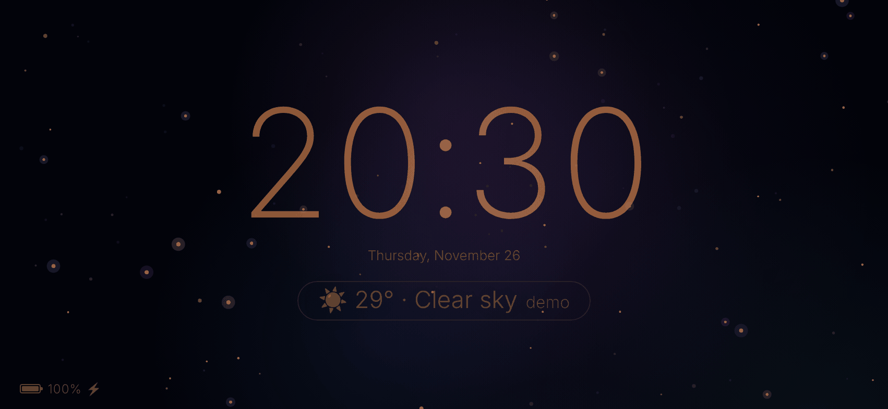
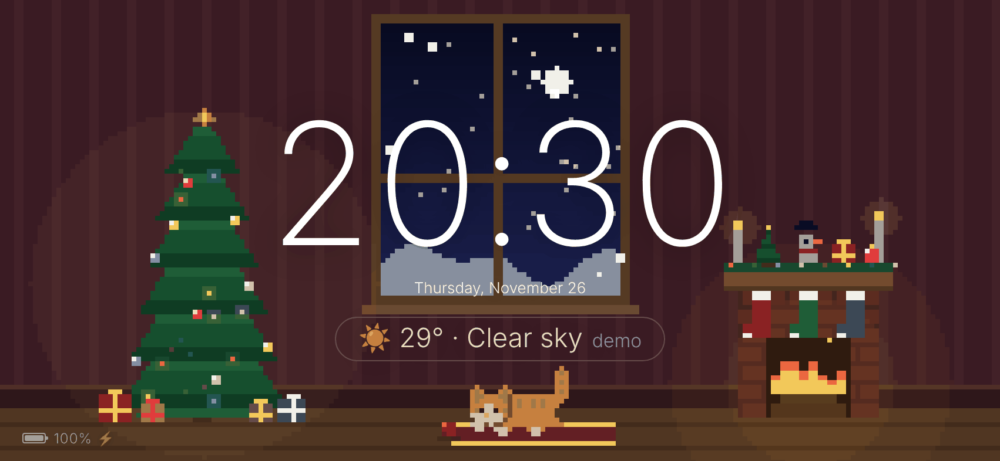
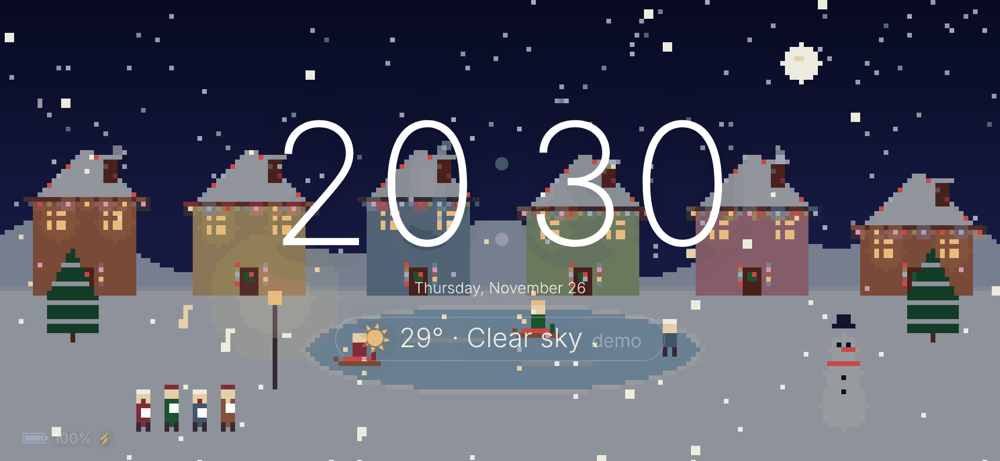

# Android Ambient Clock

An ambient desk / nightstand clock for old Android phones. Turn that spare phone into a calm, good-looking clock display: a free, offline-friendly alternative to Fliqlo-style screensavers.

Um relógio ambiente de mesa/criado-mudo para celulares Android antigos. Transforma aquele celular de apoio em um relógio agradável e útil. (Português abaixo.)

## Screenshots (landscape)

| Window | Lo-fi room |
| --- | --- |
|  |  |

| Aurora | Night |
| --- | --- |
|  |  |

Christmas scenes (Christmas mode is automatic from 1 Dec to 6 Jan, or set it manually in the menu):

| Living room | Village |
| --- | --- |
|  |  |

## Features

- **Scenes**, switch by tapping the screen:
  - **Window**: pixel-art window with sun, moon, stars, clouds, rain, storm and fog, and a cat on the windowsill.
  - **Lo-fi room**: cozy desk with a sleeping cat, steaming mug, lamp that turns on at night and a window showing the real sky.
  - **Aurora**: flowing particle art whose colors change through the day (gold/green morning, cyan/blue afternoon, pink/orange sunrise and sunset, violet/magenta night).
  - **Night**: dim amber clock for the bedroom, with the real moon phase.
  - **Christmas living room** and **Christmas village**: only shown when Christmas mode is on.
- **Seasons** (auto, or pick one) change the landscape and the cat's surroundings.
- **Follows the sun**: sunrise/sunset computed locally for your coordinates, no API needed.
- **Live weather** and rain warning from [Open-Meteo](https://open-meteo.com) (no API key).
- **Location**: use GPS or pick country, state and city in the menu.
- **Auto brightness** using the phone's light sensor, plus automatic dimming from 11pm to 6am.
- **Languages**: English and Portuguese (automatic, or choose in the menu).
- **Updates without reinstalling**: the app checks for new versions itself, or tap "Check for updates" in the menu.
- Screen always on, immersive full screen, follows screen rotation, fonts bundled (works offline).
- No ads, no tracking, no accounts, no app store.

## Install (no app store)

1. Open the **Releases** page of this repository and download `relogio-ambiente.apk` on your phone.
2. Open the file. Android will ask once to allow installs from unknown sources.
3. Open the app, tap the screen to change scenes, tap the gear icon for settings (clock size, test any time of day, demo weather, season, Christmas, location, language).

The APK is built automatically by GitHub Actions on every push to `main`. To build a new one without changes: **Actions → Build APK → Run workflow**.

## Set your location

Tap the gear icon, then **Location**: use your phone's GPS or choose country, state and city. It is used for sunrise/sunset and weather.

## Project layout

- `src/index.html`: the whole clock (HTML, CSS and JavaScript in one file). It also runs in any browser.
- `scripts/prepare-web.mjs`: copies the page to `www/` and bundles the Inter and Nunito fonts.
- `scripts/patch-android.mjs`: native tweaks (keep screen on, immersive mode, light-sensor brightness, dark theme).
- `.github/workflows/build-apk.yml`: builds the APK with [Capacitor](https://capacitorjs.com) and publishes it in Releases.
- `docs/screenshots/`: the images used in this README.

The signed-with-debug-key APK is meant for personal use. Fork it and make it yours.

---

## Português

Relógio ambiente para Android com cenas em pixel art (Janela, quartinho lo-fi, Aurora e Noturno, mais Sala e Vila de Natal), cores que acompanham o nascer e o pôr do sol, clima ao vivo, brilho automático pelo sensor de luz, tela sempre ligada e rotação automática. Sem anúncios, sem conta e sem loja de apps.

Veja os prints horizontais na seção **Screenshots (landscape)** acima.

**Instalar:** abra **Releases**, baixe `relogio-ambiente.apk` no celular e instale (o Android pede, uma vez, para permitir fontes desconhecidas).

**Sua localização:** toque na engrenagem, depois em **Localização**: use o GPS ou escolha país, estado e cidade.

**Atualizar:** o app se atualiza sozinho quando há internet, ou toque em **Verificar atualização** no menu.

**Gerar um APK novo:** aba **Actions → Build APK → Run workflow**.

## Support / Apoie

If you enjoy the clock, you can sponsor the project: [💜 GitHub Sponsors](https://github.com/sponsors/moon-rad)

Gostou do relógio? Apoie o projeto: [💜 GitHub Sponsors](https://github.com/sponsors/moon-rad)

## License

MIT, see [LICENSE](LICENSE).
